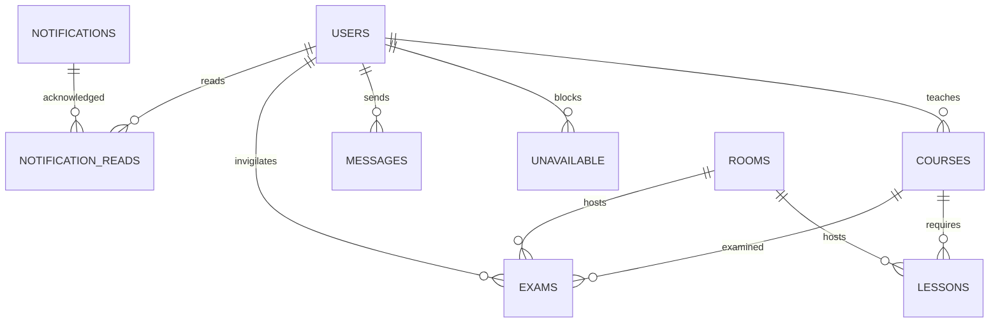

# Design notes

The extended calendar, workflow and delivery model is documented in [Academic features](ACADEMIC_FEATURES.md). Additional tables store calendar settings, holidays, leave, course patterns, exam options/staff, schedule versions, notification preferences and the delivery outbox.

## Data model

All IDs are UUID strings except stable demonstration IDs. `coordination_lock` contains a single row used by transactions to serialize coordinated updates. Foreign keys protect references; unique constraints protect email addresses, course codes, room names, room bookings, and faculty availability entries. Timestamps are epoch milliseconds; exam dates use ISO `yyyy-MM-dd` text for JDBC portability.

## Request and transaction flow

1. Tomcat routes static resources or `/api/*` servlet requests.
2. The servlet validates request size, session authentication, and the same-origin custom header for writes.
3. `CampusService` checks role permissions and validates field types, lengths, IDs, and bounds.
4. `Database.transaction` acquires the coordination lock. Scheduling and relational updates happen on the same JDBC connection.
5. `Scheduler` builds a complete candidate solution, or validates a manual update across modules.
6. Success commits the records and related notification together. Failure rolls back and returns an explanatory error.
7. The servlet broadcasts an SSE revision only after commit. Clients fetch authoritative state. TCP chat uses the same service and event notification path.

## Important tradeoffs

- A shared row lock favors understandable consistency over high write throughput. Chat writes also use this lock, so large scheduling searches can delay messages. A production implementation should separate chat write coordination and shorten schedule publication locks using version checks.
- Teaching templates are expanded within the configured semester, A/B pattern and calendar exceptions. Exams are checked against actual teaching dates. Leave cancels teaching; it does not automatically create replacements.
- The timetable search is bounded. A failure may mean impossible constraints or an exhausted search budget.
- Invigilation balances assignments greedily within a backtracking search; it does not optimize a global fairness score.
- SSE broadcasts are process-local. Multiple application instances use the same database locking strategy, but cross-instance browser updates arrive through 30-second refresh rather than a message broker.
- Account creation and password changes are implemented. Deactivation, role editing, password recovery, and private messaging are future extensions.

## Suggested viva demonstration

Explain `PreparedStatement` and a rollback in `Database`, show cohort/faculty/room sets in the scheduler, demonstrate a blocked manual move, open faculty and admin browser sessions for SSE chat, and run `ChatClient` in another terminal to show `Socket`/`ServerSocket` communication and the executor worker pool.
